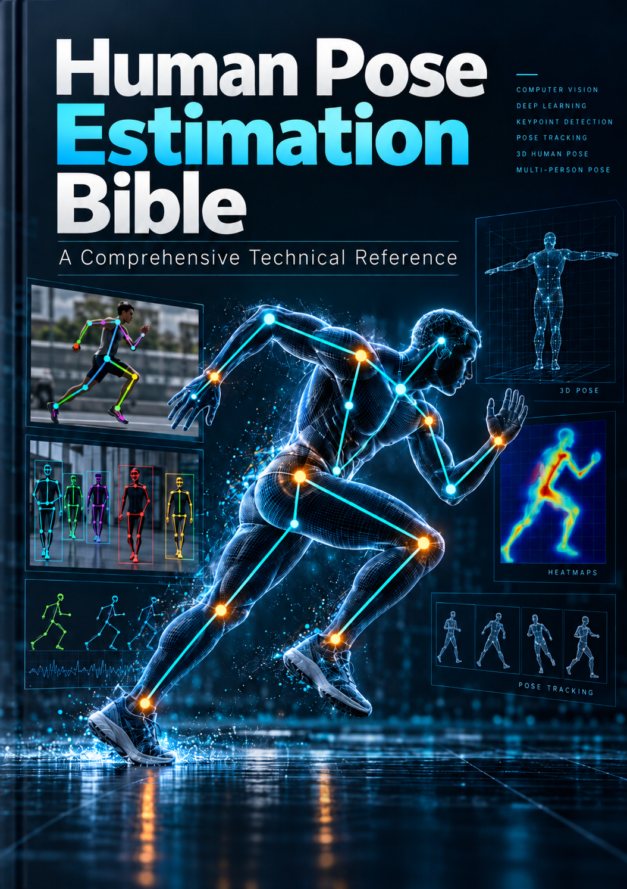

# Human Pose Estimation Bible

**A Comprehensive Technical Reference — From Computer Vision Fundamentals to Modern Deep Learning and Real-World Applications**

This repository presents **Human Pose Estimation Bible**, a collaborative graduation-project technical reference that connects computer vision fundamentals, mathematical and geometric reasoning, deep-learning architectures, evaluation methodology, and practical inference pipelines. Across four chapters and three practical case studies, it demonstrates a research-oriented AI Engineering mindset—not simply a collection of pretrained-model demos.

## Read the Full HPE Bible

**[Read the Full HPE Bible — PDF](docs/HPE-Bible.pdf)** 
[Editable / source document (DOCX)](docs/HPE-Bible.docx)

The PDF is the primary reading format; the DOCX is retained as the editable source version.

## Contents

- [The Research Mindset Behind This Work](#the-research-mindset-behind-this-work)
- [Why This Technical Reference Exists](#why-this-technical-reference-exists)
- [Inside the Bible — Chapter by Chapter](#inside-the-bible--chapter-by-chapter)
- [From Research to Real-World Implementation](#from-research-to-real-world-implementation)
- [Comparing the Practical Approaches](#comparing-the-practical-approaches)
- [Skills and Technical Knowledge Demonstrated](#skills-and-technical-knowledge-demonstrated)
- [Read the Full HPE Bible](#read-the-full-hpe-bible)
- [Project Credits and Acknowledgments](#project-credits-and-acknowledgments)

## The Research Mindset Behind This Work

I am **Mostafa Khaled**, a recent graduate pursuing opportunities in AI Engineering, Machine Learning, Data Science, and Computer Vision. I am developing as a **research-oriented AI / Computer Vision Engineer** because Human Pose Estimation exposes the full chain between visual evidence and structured understanding: pixels become features, features become anatomical keypoints, and keypoints must remain geometrically and temporally coherent.

My interest is therefore not limited to calling a model API or running a pretrained checkpoint. I want to understand why different architectures work, how resolution and representation choices affect learning and inference, which assumptions break under occlusion or depth ambiguity, and how evaluation metrics should influence deployment decisions. This book was a collaborative graduation project; this repository is my portfolio-oriented presentation of that work and of the research-oriented engineering perspective I developed through it.

## Why This Technical Reference Exists

Human Pose Estimation sits at the intersection of several disciplines: classical computer vision, 2D and 3D representations, deep learning, body modeling, geometric and kinematic reasoning, benchmarking, and practical video pipelines. These topics are often taught separately even though a production system must connect them.

The reference was organized as a **structured study** that connects fundamentals, research evolution, modern architectures, and practical implementation—from skeletal and volumetric models, to coordinate regression and heatmaps, to multi-person association, temporal tracking, and deployment trade-offs. It offers broad coverage within its stated scope, but it is not intended to be an exhaustive survey of every HPE study or technique.

## What This Book Covers

The four chapters move from the problem landscape and evaluation foundations, through classical and deep-learning approaches, to a taxonomy of representative architectures and three practical implementation case studies. The appendices preserve the detailed implementation material that would otherwise make a portfolio README difficult to scan.

## Inside the Bible — Chapter by Chapter

### Chapter 1 — Human Pose Estimation Landscape (HPE)

Defines HPE and surveys applications in activity recognition, healthcare, robotics, animation, sports, safety, and human–computer interaction. It contrasts 2D and 3D pose, then examines occlusion, crowd complexity, depth ambiguity, scale and viewpoint variation, rare poses, annotation cost, privacy, adverse imaging conditions, and temporal inconsistency. The chapter also explains PCP, PCK, PDJ, MPJPE, OKS, AP, AR, AUC, and NME alongside benchmark datasets including MPII, COCO, LSP/LSPE, CrowdPose, Human3.6M, PoseTrack, AI Challenger, and 3DPW. Its key lesson is methodological: a score is meaningful only in the context of the dataset, representation, protocol, and metric that produced it.

### Chapter 2 — Human Pose Estimation Approaches

Builds the modeling vocabulary needed to compare HPE systems: kinematic/skeleton-based, planar/part-based, and volumetric body models; classical and learning-based methods; coordinate regression versus heatmap localization; single-person versus multi-person estimation; and top-down versus bottom-up pipelines. For 3D HPE it covers monocular reconstruction, direct regression, 2D-to-3D lifting, volumetric heatmaps, parametric body models, and multi-view reasoning. The chapter matters because it frames architecture selection as a set of mathematical and engineering trade-offs rather than a search for one universally best model.

### Chapter 3 — HPE Using Deep Learning

The central architecture-focused chapter studies CNN feature extraction, output representations, resolution recovery, skip connections, dilated convolutions, and multi-scale spatial reasoning. It then examines self- and cross-attention, Transformer backbones, Graph Neural Networks for skeletal structure and temporal reasoning, diffusion-based pose refinement and uncertainty, and emerging vision–language/LLM integration. The reader learns how each family addresses different limitations—localization precision, long-range context, structural consistency, ambiguity, or semantic conditioning. These subjects are analyzed in the book; they should not be read as claims that every architecture was independently implemented in the practical suite.

### Chapter 4 — Taxonomy of HPE Models & Practical Implementation

Reviews representative systems including OpenPose, HRNet, YOLO-Pose/YOLOv8-Pose, RTMPose, ViTPose/ViTPose++, Human Mesh Recovery (HMR), PoseFormer, and MANO. It then introduces the HPE-Bible Project Suite and compares three implementation strategies. This chapter bridges model architecture study with engineering practice; Appendices A–C provide the detailed implementation material.

## From Research to Real-World Implementation

The practical work explores different ways to solve different pose-estimation problems instead of treating one architecture as universal.

### Appendix A — Wide-Field Pose Estimation with YOLOv8 and Image Tiling

**Problem:** Players in wide-field football broadcasts may occupy too few pixels for reliable fine-grained keypoint localization. **Approach:** Split each frame into a configurable grid, run YOLOv8-Pose on each tile, and remap local keypoints into the original coordinate system. The case study highlights tiling, coordinate offsets, small-subject localization, COCO’s 17-keypoint topology, and the resolution–compute trade-off. More spatial detail can help distant subjects, but grid size increases inference work and introduces boundary-truncation and merging concerns.

### Appendix B — Two-Stage Human Pose Estimation

**Problem:** Accurate multi-person localization requires careful handling of detection, person crops, and pose inference. **Pipeline:** `Input → YOLO person detection → bounding boxes → person crops → YOLOv8-Pose → keypoint visualization`. The modular design separates detection from keypoint estimation, supports independent model sizing, filters low-quality detections, and can derive pose-based actions. Its trade-off is better per-person control at the cost of crop handling and additional computation.

### Appendix C — RTMPose with Multi-Person Tracking

**Problem:** Video analysis must estimate keypoints while preserving identity across frames. **Pipeline:** `Video frames → RTMDet → RTMPose → ByteTrack → visualization and tracking`. The implementation combines OpenMMLab’s MMDetection and MMPose ecosystems with RTMPose’s coordinate-classification approach and ByteTrack’s multi-object association. It also documents practical integration concerns such as registry-scope management, track state, confidence thresholds, and temporal consistency. No independent FPS result is claimed here.

## Comparing the Practical Approaches

| Approach | Primary objective | Strategy | Core frameworks | Target use case | Tracking | Main trade-off |
|---|---|---|---|---|---|---|
| YOLOv8 + tiling | Recover detail for distant subjects | Tile, infer locally, remap coordinates | Ultralytics YOLOv8, OpenCV | Wide-field sports and surveillance | Not the central focus | Better effective resolution, higher compute and boundary complexity |
| YOLOv8 two-stage | Improve per-person pose control | Detect people, crop, then estimate pose | YOLOv8, OpenCV | Groups, action and fitness analysis | Optional pipeline support | Modular tuning and precision, but extra stages and crop overhead |
| RTMPose + ByteTrack | Efficient video pose with identity continuity | Top-down detection, pose estimation, association | MMDetection, MMPose, RTMPose, ByteTrack | Multi-person football video and temporal analysis | Integrated | Strong pipeline coordination, dependency and integration complexity |

The right choice depends on subject scale, crowding, temporal requirements, hardware budget, and whether identity continuity matters. Architecture selection should follow the deployment constraint and evaluation protocol—not a generic assumption that one model is always superior.

## Skills and Technical Knowledge Demonstrated

- **Scientific and research:** literature synthesis, architecture analysis, metric and benchmark literacy, mathematical reasoning, and comparative methodology.
- **Computer vision:** 2D/3D HPE, object detection, keypoint localization, skeletal representation, video processing, and multi-person tracking.
- **Deep learning:** CNNs, Transformers, GNNs, diffusion models, and vision–language integration as studied in the reference.
- **Engineering:** modular inference pipelines, coordinate transformations, model integration, crop and bounding-box handling, tracking integration, and computational-efficiency reasoning.

The practical suite specifically demonstrates YOLOv8-Pose, image tiling, two-stage detection/pose processing, RTMDet, RTMPose, ByteTrack, OpenCV, Ultralytics, MMDetection, and MMPose. GNNs, diffusion, Vision-Language Models, HMR, ViTPose, PoseFormer, and MANO are part of the technical study and taxonomy; their inclusion does not imply implementation in these three case studies.

## Book Navigation

[View the book cover](assets/cover.png)

Quick navigation:

1. [Chapter 1 — Landscape](#chapter-1--human-pose-estimation-landscape-hpe)
2. [Chapter 2 — Approaches](#chapter-2--human-pose-estimation-approaches)
3. [Chapter 3 — Deep Learning](#chapter-3--hpe-using-deep-learning)
4. [Chapter 4 — Taxonomy and Implementation](#chapter-4--taxonomy-of-hpe-models--practical-implementation)
5. [Appendix A — Tiled YOLOv8](#appendix-a--wide-field-pose-estimation-with-yolov8-and-image-tiling)
6. [Appendix B — Two-stage YOLOv8](#appendix-b--two-stage-human-pose-estimation)
7. [Appendix C — RTMPose and tracking](#appendix-c--rtmpose-with-multi-person-tracking)

The PDF is the recommended reading format. The DOCX remains available above for editing and source preservation.

## Project Credits and Acknowledgments

The graduation project identifies the following contributors:

**Hadi Shaheen · Mostafa Khaled · Marawan Sitten · Mohamed Salah · Mosa Mohamed**

The collaborative source-code repository is [HadiShaheen249/HPE-Bible](https://github.com/HadiShaheen249/HPE-Bible). This repository is Mostafa Khaled’s portfolio presentation of the technical reference and the research-oriented experience developed through the project; it does not claim exclusive ownership of the team’s original implementations.

## Publication-Readiness Notes

Before public release, review the bibliography and add complete, consistent citations for named methods, datasets, metrics, figures, and external model implementations. Also confirm usage rights and credits for the cover and embedded figures, and add a project/code license only when the contributors have authorization to do so. The README intentionally avoids unverified benchmark scores, FPS claims, citation counts, and claims of independent experiments.

This work reflects how I approach Artificial Intelligence: understand the underlying science, compare alternative solutions critically, and translate that understanding into engineering decisions that can survive real-world constraints.
